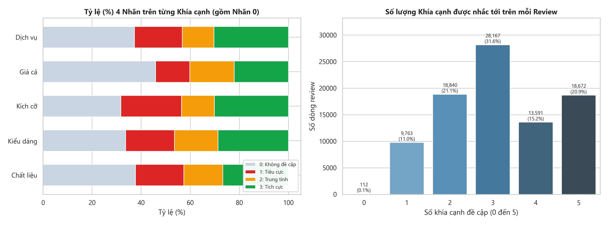
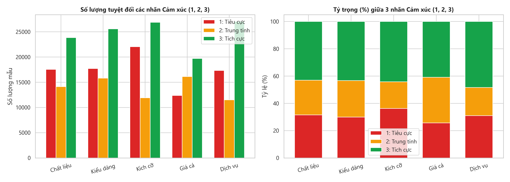
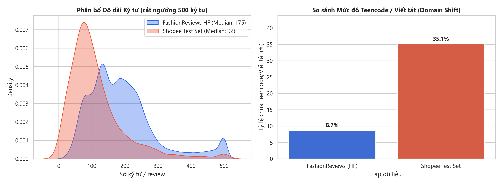
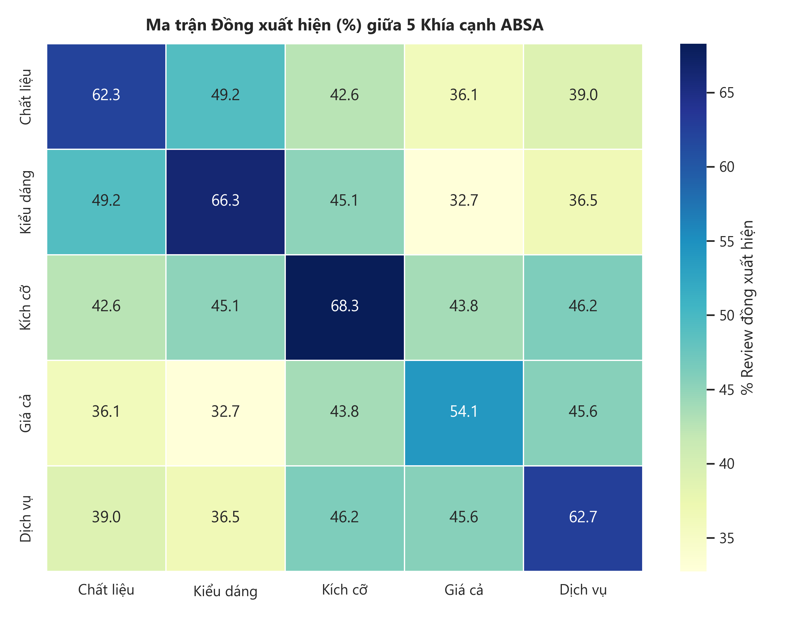

# Báo cáo EDA: Tập dữ liệu `vinhplaykennen/FashionReviews` (HuggingFace)

## 1. Chỉ số Tổng quan & Sức khỏe Dữ liệu (Data Integrity)
- **Tổng số dòng**: `89,145` dòng | **Số cột**: `7`
- **Giá trị khuyết (`NaN`)**: `Nội dung review`: `0` | `Chất liệu`: `6`, `Kiểu dáng`: `18`, `Kích cỡ`: `12`, `Giá cả`: `13`, `Dịch vụ`: `21`
- **Số dòng trùng lặp nguyên văn (`Exact Duplicates`)**: **`135`** (0.15%)
- **Số dòng trùng lặp sau chuẩn hóa (`Normalized Duplicates`)**: **`135`** (0.15%) $\rightarrow$ Chỉ còn **`89,010`** câu review duy nhất!
- **Số dòng quá ngắn (< 10 ký tự)**: `2`
- **Số dòng không đề cập khía cạnh nào (cả 5 cột = `0`)**: `112` (0.13%)
- **Tập giá trị nhãn kiểm tra được**: `Chất liệu`: `[0.0, 1.0, 2.0, 3.0]`; `Kiểu dáng`: `[0.0, 1.0, 2.0, 3.0]`; `Kích cỡ`: `[0.0, 1.0, 2.0, 3.0]`; `Giá cả`: `[0.0, 1.0, 2.0, 3.0]`; `Dịch vụ`: `[0.0, 1.0, 2.0, 3.0]`

---

## 2. Phân bố 4 Nhãn (`0, 1, 2, 3`) trên 5 Khía cạnh ABSA

| Khía cạnh | `0: Không đề cập` | `1: Tiêu cực` | `2: Trung tính` | `3: Tích cực` | Tỷ lệ có đề cập (`1,2,3`) |
| :--- | :---: | :---: | :---: | :---: | :---: |
| **Chất liệu** | 33,598 (37.7%) | 17,545 (19.7%) | 14,133 (15.9%) | 23,863 (26.8%) | **55,541 (62.3%)** |
| **Kiểu dáng** | 29,996 (33.6%) | 17,711 (19.9%) | 15,827 (17.8%) | 25,593 (28.7%) | **59,131 (66.3%)** |
| **Kích cỡ** | 28,262 (31.7%) | 22,058 (24.7%) | 11,931 (13.4%) | 26,882 (30.2%) | **60,871 (68.3%)** |
| **Giá cả** | 40,904 (45.9%) | 12,383 (13.9%) | 16,126 (18.1%) | 19,719 (22.1%) | **48,228 (54.1%)** |
| **Dịch vụ** | 33,227 (37.3%) | 17,332 (19.4%) | 11,524 (12.9%) | 27,041 (30.3%) | **55,897 (62.7%)** |

---

## 3. Cân bằng Nội tại giữa 3 Nhãn Cảm xúc (`1: Tiêu cực`, `2: Trung tính`, `3: Tích cực`)

| Khía cạnh | `1: Tiêu cực` (%) | `2: Trung tính` (%) | `3: Tích cực` (%) |
| :--- | :---: | :---: | :---: |
| **Chất liệu** | 17,545 (31.6%) | 14,133 (25.4%) | 23,863 (43.0%) |
| **Kiểu dáng** | 17,711 (30.0%) | 15,827 (26.8%) | 25,593 (43.3%) |
| **Kích cỡ** | 22,058 (36.2%) | 11,931 (19.6%) | 26,882 (44.2%) |
| **Giá cả** | 12,383 (25.7%) | 16,126 (33.4%) | 19,719 (40.9%) |
| **Dịch vụ** | 17,332 (31.0%) | 11,524 (20.6%) | 27,041 (48.4%) |

---

## 4. So sánh Domain Shift với Tập Test Shopee của Bạn
- **Độ dài văn bản `FashionReviews` (HF)**: Trung vị = `175.0` ký tự | Trung bình = `192.1` ký tự | Tỷ lệ chứa Teencode/Viết tắt: **`8.7%`**.
- **Độ dài văn bản `Shopee Test Set` của bạn**: Trung vị = `92.0` ký tự | Trung bình = `117.4` ký tự | Tỷ lệ chứa Teencode/Viết tắt: **`35.1%`**.

