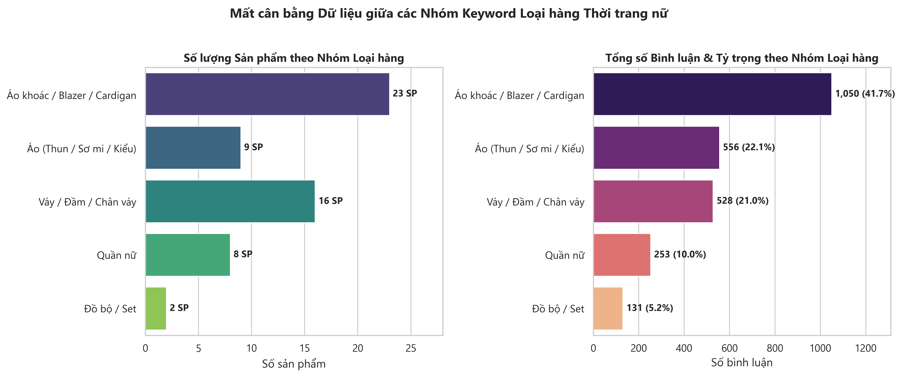
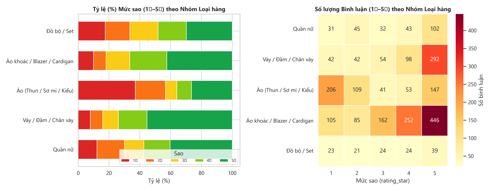
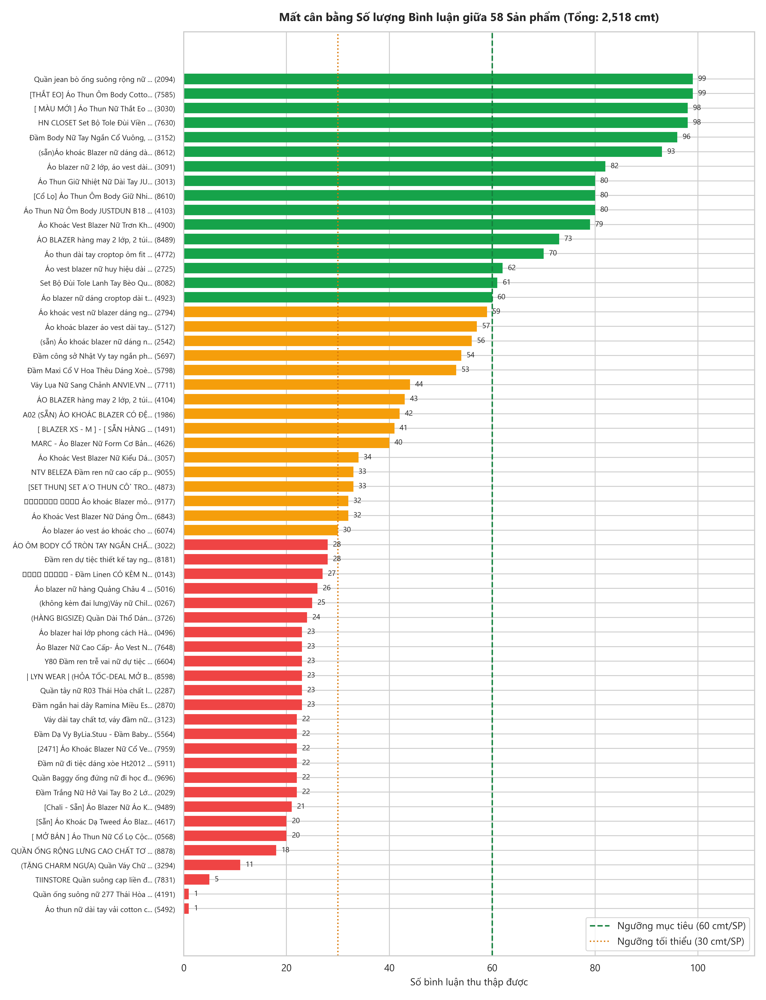
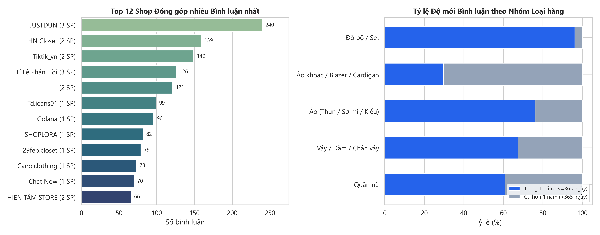
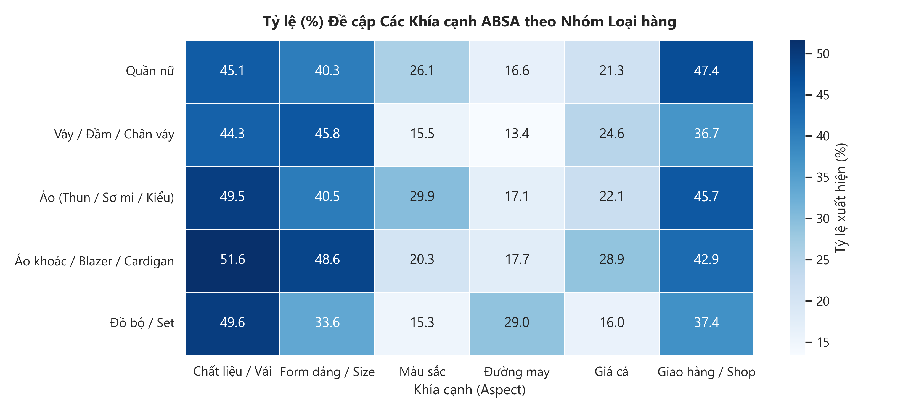

# Báo cáo EDA: Phân tích Mất cân bằng giữa Sản phẩm & Các Keyword Loại hàng

- **Tổng số sản phẩm**: `58`
- **Tổng số bình luận hợp lệ**: `2,518`
- **Số bình luận/sản phẩm**: Min = `1`, Trung vị = `32.5`, Trung bình = `43.4`, Max = `99`
- **Tỷ lệ đạt chuẩn mật độ**: `>= 60 cmt`: **16 SP** (27.6%) | `30–59 cmt`: **16 SP** (27.6%) | `< 30 cmt`: **26 SP** (44.8%)

---

## 1. Mất cân bằng giữa các Nhóm Keyword Loại hàng Thời trang nữ

| Nhóm Keyword / Loại hàng | Số SP | Số Bình luận | Tỷ trọng (%) | TB cmt/SP |
| :--- | :---: | :---: | :---: | :---: |
| Áo khoác / Blazer / Cardigan | 23 | 1,050 | 41.7% | 45.7 |
| Áo (Thun / Sơ mi / Kiểu) | 9 | 556 | 22.1% | 61.8 |
| Váy / Đầm / Chân váy | 16 | 528 | 21.0% | 33.0 |
| Quần nữ | 8 | 253 | 10.0% | 31.6 |
| Đồ bộ / Set | 2 | 131 | 5.2% | 65.5 |

---

## 2. Phân bố Mức sao (`rating_star`) theo từng Nhóm Loại hàng

| Nhóm Keyword / Loại hàng | 1★ | 2★ | 3★ | 4★ | 5★ | Tổng |
| :--- | :---: | :---: | :---: | :---: | :---: | :---: |
| Quần nữ | 31 | 45 | 32 | 43 | 102 | **253** |
| Váy / Đầm / Chân váy | 42 | 42 | 54 | 98 | 292 | **528** |
| Áo (Thun / Sơ mi / Kiểu) | 206 | 109 | 41 | 53 | 147 | **556** |
| Áo khoác / Blazer / Cardigan | 105 | 85 | 162 | 252 | 446 | **1050** |
| Đồ bộ / Set | 23 | 21 | 24 | 24 | 39 | **131** |

---

## 3. Mất cân bằng giữa các Sản phẩm (Top 5 cao nhất vs Top 5 thấp nhất)

### Top 5 Sản phẩm nhiều bình luận nhất:
| Product ID | Tên sản phẩm | Nhóm hàng | Số cmt |
| :--- | :--- | :--- | :---: |
| `shopee_691586816_28716872094` | Quần jean bò ống suông rộng nữ xuông jeans cạp cao p... | Quần nữ | **99** |
| `shopee_186979045_51950177585` | [THẮT EO] Áo Thun Ôm Body Cotton Mịn Co Giãn- KENCO ... | Áo (Thun / Sơ mi / Kiểu) | **99** |
| `shopee_1514216378_28733253030` | [ MÀU MỚI ] Áo Thun Nữ Thắt Eo Ôm Body BYJANE chất t... | Áo (Thun / Sơ mi / Kiểu) | **98** |
| `shopee_506105276_41319147630` | HN CLOSET Set Bộ Tole Đùi Viền Bèo Áo Baby Doll, Set... | Đồ bộ / Set | **98** |
| `shopee_684640396_23550433152` | Đầm Body Nữ Tay Ngắn Cổ Vuông, Đầm Nữ Dáng Dài Diamo... | Váy / Đầm / Chân váy | **96** |

### Top 5 Sản phẩm ít bình luận nhất:
| Product ID | Tên sản phẩm | Nhóm hàng | Số cmt |
| :--- | :--- | :--- | :---: |
| `shopee_1175585681_43874685492` | Áo thun nữ dài tay vải cotton co giãn thoải mái, mềm... | Áo (Thun / Sơ mi / Kiểu) | **1** |
| `shopee_1590321015_41779314191` | Quần ống suông nữ 277 Thái Hòa chất liệu Rayol phối ... | Quần nữ | **1** |
| `shopee_234757862_24258467831` | TIINSTORE Quần suông cạp liền đính khuy bọc chéo Q0D104 | Quần nữ | **5** |
| `shopee_1574592857_46160933294` | (TẶNG CHARM NGỰA) Quần Váy Chữ A Chấm Bi Nữ Chân Váy... | Váy / Đầm / Chân váy | **11** |
| `shopee_1068715551_22280738878` | QUẦN ỐNG RỘNG LƯNG CAO CHẤT TƠ ĐŨI LOẠI 1 MỀM MỊN LÊ... | Quần nữ | **18** |

---

## 4. Độ phủ Shop, Độ mới Dữ liệu & Khía cạnh ABSA

